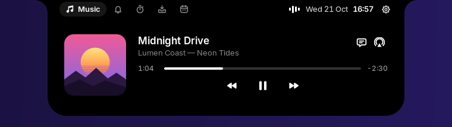
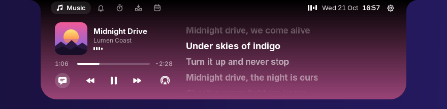
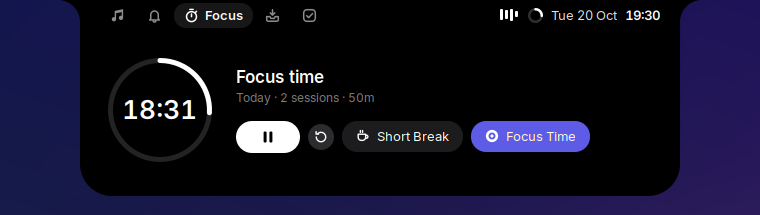
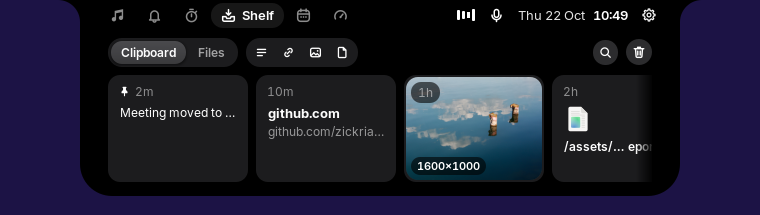
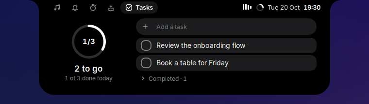
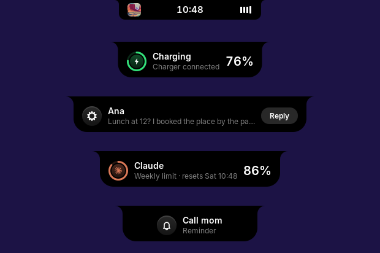

<div align="center">

# Isle

**A dynamic island for the GNOME desktop.**

Music with synced lyrics, notifications, a focus timer, tasks and a
clipboard shelf, living in a notch at the top of your screen.

[](LICENSE)


</div>

Isle turns the centre of the top bar into a black notch, like a MacBook's.
At rest it shows the time and what is going on (a song, a timer, a
recording). Hover it and it opens with spring physics into a small panel with
tabs for each page. Alerts for volume, charging, Caps Lock and notifications
appear in the same place instead of in the middle of the screen.

## Contents

- [Features](#features)
- [Requirements](#requirements)
- [Installation](#installation)
- [Usage](#usage)
- [Settings](#settings)
- [Resource usage](#resource-usage)
- [Privacy](#privacy)
- [Troubleshooting](#troubleshooting)
- [Uninstalling](#uninstalling)
- [How it works](#how-it-works)
- [Contributing](#contributing)
- [License](#license)

## Features

| | |
|---|---|
|  | **Music.** Spotify, YouTube in your browser, or any MPRIS player: cover art with the playing app's icon, a scrubber and controls. Volume and output switching are one click away. |
|  | **Synced lyrics** from [LRCLIB](https://lrclib.net). The island widens and takes the cover's colour; click a line to jump to it. |
|  | **Focus timer** (Pomodoro) with breaks, daily totals and Do Not Disturb while you focus. Its ring stays visible in the closed island. |
|  | **Shelf.** A clipboard history of text, links, images and files (search, filter, pin; Super+V to paste), and a files tray: drop files on the island, then drag them into any app. |
|  | **Tasks.** A plain list for today: add, tick off, rename in place. Finished tasks fold away and clear at midnight. |
|  | **Alerts** for volume, brightness, Caps Lock, charging, low battery, Bluetooth devices with their battery, going offline, and GNOME notifications, which also collect on a **Notifications** page with Do Not Disturb. |

Also: privacy dots while the camera, microphone or screen sharing is in use,
a recording timer with a stop button, and a slim glass top bar that leaves
your windows uncovered.

## Requirements

- **GNOME Shell 46** on Wayland or X11 (Ubuntu 24.04, Fedora 40, …), on a
  64-bit Intel or AMD PC (x86_64).
- `curl`, which most systems have.

## Installation

Run this in a terminal:

```sh
curl -fsSL https://raw.githubusercontent.com/zickrian/isle/main/get.sh | bash
```

Then **log out and back in**: GNOME Shell on Wayland only loads a new
extension at login (on X11, press Alt+F2, type `r` and press Enter instead).

The script downloads the latest release, checks it, and installs it for your
user only: no root, no compiler and no cloning needed. Run the same command
again to update.

> [!NOTE]
> The installer turns off settings and extensions that would fight with the
> island: Blur my Shell's top bar blur (the rest of its blur stays), and
> extensions that take the same place in the top bar. Isle's look is the
> same on every desktop: a slim top bar with no colour of its own, and the
> island as a black notch.

<details>
<summary><b>Other ways to install</b></summary>

**From a release package.** Download `isle-<version>-x86_64-linux.tar.gz`
from [Releases](../../releases), then:

```sh
tar -xzf isle-*-x86_64-linux.tar.gz
cd isle-*-x86_64-linux
./install.sh
```

**From source**, for development or other architectures. You need Rust 1.85
or newer ([rustup](https://rustup.rs); Ubuntu 24.04's own `cargo` is too
old) and, for the shelf's drag and drop, the GTK 4 development files:

```sh
sudo apt install git build-essential pkg-config libgtk-4-dev   # Fedora: git gcc pkgconf gtk4-devel
curl --proto '=https' --tlsv1.2 -sSf https://sh.rustup.rs | sh
git clone https://github.com/zickrian/isle.git
cd isle
./install.sh
```

</details>

## Usage

| Do this | To |
|---|---|
| Hover the notch | Open the island |
| Click a tab, or swipe sideways with two fingers | Switch pages |
| Move the pointer away, or press Esc | Close it |
| Click the notch | Open it now; on an alert, open what it is about |
| Middle-click the notch | Play or pause |
| Right-click the notch | Bring the music player to the front |
| Super+V | Open the clipboard history with search ready; Enter pastes |
| Drag a file towards the notch | Open the files tray to drop it |

The island reopens on the page you picked last (for five minutes), or on
what is live: unseen notifications, music, a running timer.

## Settings

Open the **Extensions** app and click the gear next to Isle:

- **Top bar:** glass (default), black, or your theme's colour; the closed
  island inside the bar or hanging below it.
- **Alerts:** volume and brightness, battery and network, privacy dots, new
  songs, timer sounds.
- **Clipboard:** turn the history on or off, clear it, and choose apps whose
  copies are never kept (password managers are on the list from the start).
- **Focus timer:** session and break lengths, Do Not Disturb while focusing.

## Resource usage

Isle is built to run all day unnoticed. Measured on Ubuntu 24.04 with
GNOME 46:

| Part | Memory | CPU when idle |
|---|---|---|
| `isled` (background service) | 7.4 MB resident, of which about 0.7 MB its own | 0% (no polling) |
| Extension, inside GNOME Shell | about 10 MB more for the shell | 0% when nothing moves |
| `isle-shelf` (drag and drop) | about 28 MB, GTK 4 drawn on the CPU; only after the files tray is first opened | 0% |

| On disk | Size |
|---|---|
| Programs (`isled` 8.5 MB, `isle-shelf` 1.9 MB) | 10.4 MB |
| Extension | 0.5 MB |
| Inter typeface | 0.9 MB |
| Cache (`~/.cache/isle`) | about 100 KB per song's cover and 6 KB per lyrics |

Animations run on the display's frame clock only while a spring moves and
stop when it settles. The clock wakes once a minute, lyrics exactly when the
next line starts, and pages only tick while they are open.

## Privacy

Isle runs locally. The clipboard history, tasks and timer stay in
`~/.local/share/isle` and never leave your computer; copies from password
managers are never kept. The only network requests are a lyrics lookup on
[LRCLIB](https://lrclib.net) and the cover art the player points to, once
per song, both then cached.

## Troubleshooting

**The island does not appear after installing.** Log out and back in (on
Wayland this is required once). Then check that it is enabled:
`gnome-extensions info isle@zickrian.github.io`.

**Music or lyrics do not show.** Check that the background service runs:
`systemctl --user status isled`, and read its log with
`journalctl --user -u isled -f`. Songs LRCLIB does not know show "No lyrics
found"; a busy service retries on its own.

**Files cannot be dragged in or out.** The release package includes the
drag-and-drop helper; when building from source, install `libgtk-4-dev`
(Fedora: `gtk4-devel`) and run `./install.sh` again.

**Another extension covers the island.** Extensions that restyle or move the
top bar (Dash to Panel, Hide Top Bar, other islands) can get in the way;
turn them off in the Extensions app.

**Something else.** GNOME Shell's log shows extension errors:
`journalctl -f -o cat /usr/bin/gnome-shell`. Please
[open an issue](../../issues) with what you see.

## Uninstalling

```sh
isle-uninstall
```

(or `./uninstall.sh` from the release package or the source folder). This
removes the extension, the programs, the service and the font. Your
tasks, clipboard history, shelf and timer settings stay in
`~/.local/share/isle` until you delete that folder.

## How it works

```
┌────────────────── isled (Rust) ──────────────────┐
│ MPRIS · lyrics · timer · tasks · shelf           │
│ UPower · NetworkManager · BlueZ                  │
│            exposed on D-Bus (zbus)               │
└────────────────────────┬─────────────────────────┘
           ┌─────────────┴──────────────┐
  GNOME Shell extension (JS)      isle-shelf (Rust, GTK 4)
  draws the island and its        drag-and-drop window laid
  animations                      over the files tray
```

GNOME Shell extensions are written in JavaScript, and on Wayland only the
shell can draw into the top bar. So the extension only draws, and everything
else lives in Rust behind a D-Bus API.

| Path | Contents |
|---|---|
| `crates/isle-core` | Platform-independent logic: LRC parsing, track-title clean-up, Pomodoro, tasks, shelf, clipboard history. Unit tested. |
| `crates/isle-daemon` | `isled`, the D-Bus service. |
| `crates/isle-shelf` | `isle-shelf`, the files tray's drag-and-drop window. |
| `gnome-extension` | The GNOME Shell extension. |
| `data` | systemd and D-Bus activation files, and the Inter typeface. |
| `docs/product-spec.md` | How the island looks and behaves: sizes, motion, pages, alerts. |
| `docs/dbus-api.md` | The D-Bus interfaces of `isled` and `isle-shelf`. |

## Contributing

Bug reports, ideas and pull requests are welcome. See
[CONTRIBUTING.md](CONTRIBUTING.md) for how to build, test and send changes,
and [CHANGELOG.md](CHANGELOG.md) for what changed. Everyone taking part
follows the [Code of Conduct](CODE_OF_CONDUCT.md); please report security
problems privately as described in [SECURITY.md](SECURITY.md).

## License

Isle is free software under the
[GNU General Public License v3.0 or later](LICENSE).

The bundled [Inter](https://rsms.me/inter/) typeface (`data/fonts`) is under
the [SIL Open Font License 1.1](data/fonts/Inter-LICENSE.txt). Lyrics come
from [LRCLIB](https://lrclib.net). Isle is inspired by the iPhone's Dynamic
Island and by [NotchNook](https://lo.cafe/notchnook) and
[Boring Notch](https://github.com/TheBoredTeam/boring.notch) on the Mac.
