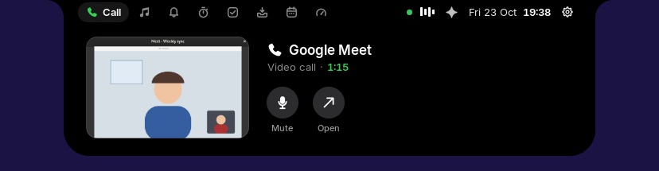
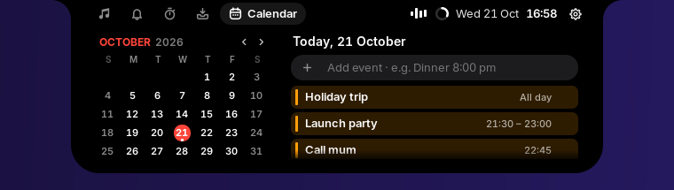
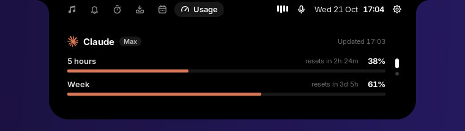

<div align="center">

# Isle

**A dynamic island for the GNOME desktop.**

Music with synced lyrics, calls, notifications, a focus timer beside your
reminders, a calendar, a clipboard shelf, and a voice assistant that works
with the AI you already use, living in a notch at the top of your screen.

[](LICENSE)


</div>

Isle turns the centre of the top bar into a black notch, like a MacBook's.
At rest it shows the time and what is going on (a song, a timer, a
recording). Rest the pointer on it and it opens with spring physics into a
small panel with tabs for each page; passing over it on the way elsewhere
leaves it closed. Alerts for volume, charging, Caps Lock and notifications
appear in the same place instead of in the middle of the screen.

## Contents

- [Features](#features)
- [Requirements](#requirements)
- [Installation](#installation)
- [Usage](#usage)
- [Settings](#settings)
- [Voice assistant](#voice-assistant)
- [AI usage](#ai-usage)
- [Resource usage](#resource-usage)
- [Privacy](#privacy)
- [Troubleshooting](#troubleshooting)
- [Uninstalling](#uninstalling)
- [How it works](#how-it-works)
- [Contributing](#contributing)
- [License](#license)

## Features

| | |
|---|---|
|  | **Music.** Spotify, YouTube in your browser, or any MPRIS player: cover art with the playing app's icon, a scrubber and controls. Volume and output switching are one click away. |
|  | **Synced lyrics** from [LRCLIB](https://lrclib.net), like Apple Music's: the line being sung large and bright, pauses as breathing dots. The island widens and takes the cover's colour; click a line to jump to it. |
|  | **Calls** in WhatsApp, Telegram, Meet or any app or browser: the closed island shows a green phone and how long the call has lasted. Open it to see the call live (you and whoever you call) while you work in other windows, mute your microphone, or jump back to the call. |
|  | **Focus.** A Pomodoro timer with breaks, daily totals and Do Not Disturb while you focus, beside today's **Reminders**, so what to work on sits next to the time to work on it. Reminders are a plain list as macOS shows them: add, rename in place, tick one off and it is struck through, then goes. The timer's ring stays visible in the closed island. |
|  | **Shelf.** A clipboard history of text, links, images and files (search, filter, pin; Super+V to paste), and a files tray: drop files on the island, then drag them into any app or click one to copy it, ready to paste into a chat. |
|  | **Calendar.** The month beside the chosen day's events, like macOS's Calendar widget. Shows your desktop calendars (Google and others through Online Accounts) and events you add in a line: "Dinner 8:00 pm". |
|  | **Voice assistant.** Press Super+I and ask, in English or Indonesian: play a song, find a file, close a window, add a reminder, explain why the laptop is slow. It works as an agent, searching your files, apps and the web itself and showing each step, with the AI you already use (Claude Code, Codex or Antigravity). |
|  | **AI usage.** How much of your Claude and ChatGPT plans' limits is used: one plan at a time with its logo, a bar per limit it has (5 hours, the week) and when each resets; scroll up or down, or click the dots, to switch. A warning comes as one nears its end. Only the ones you are signed in to show. |
|  | **Alerts** for volume, brightness, Caps Lock, charging, low battery, Bluetooth devices with their battery, going offline, and GNOME notifications, which also collect on a **Notifications** page with Do Not Disturb. |

Also: privacy dots while the camera, microphone or screen sharing is in use,
a recording timer with a stop button, and a slim glass top bar that leaves
your windows uncovered.

## Requirements

- **GNOME Shell 46 to 51** (Ubuntu 24.04 to 26.10, Fedora 40 to 45,
  Debian 13, …), on a 64-bit Intel or AMD PC (x86_64). Check with
  `gnome-shell --version`.
- `curl`, which most systems have.
- For the voice assistant (optional): a microphone, Python 3 with venv, and
  one of Claude Code, Codex or Antigravity signed in; see
  [Voice assistant](#voice-assistant).

## Installation

1. Run this in a terminal:

   ```sh
   curl -fsSL https://raw.githubusercontent.com/zickrian/isle/main/get.sh | bash
   ```

2. **Log out and back in**: GNOME Shell on Wayland only loads a new
   extension at login (on GNOME 46 to 48 with X11, press Alt+F2, type `r`
   and press Enter instead).

That's all. The script downloads the latest release, checks it, and installs
it for your user only: no root, no compiler and no cloning needed. Run the
same command again to update.

The [installation guide](docs/install.md) goes through it step by step, with
updating, uninstalling, installing offline and what to do if the island does
not appear.

> [!NOTE]
> The installer turns off settings and extensions that would fight with the
> island: Blur my Shell's top bar blur (the rest of its blur stays), and
> extensions that take the same place in the top bar. Isle's look is the
> same on every desktop: a slim top bar with no colour of its own, and the
> island as a black notch.

<details>
<summary><b>Other ways to install</b></summary>

**From a release package.** Download `isle-<version>-x86_64-linux.tar.gz`
from [Releases](../../releases), then:

```sh
tar -xzf isle-*-x86_64-linux.tar.gz
cd isle-*-x86_64-linux
./install.sh
```

**From source**, for development or other architectures. You need Rust 1.85
or newer ([rustup](https://rustup.rs); Ubuntu 24.04's own `cargo` is too
old) and, for the shelf's drag and drop, the GTK 4 development files:

```sh
sudo apt install git build-essential pkg-config libgtk-4-dev   # Fedora: git gcc pkgconf gtk4-devel
curl --proto '=https' --tlsv1.2 -sSf https://sh.rustup.rs | sh
git clone https://github.com/zickrian/isle.git
cd isle
./install.sh
```

</details>

## Usage

| Do this | To |
|---|---|
| Rest the pointer on the notch | Open the island |
| Click a tab, or swipe sideways with two fingers | Switch pages |
| Move the pointer away, or press Esc | Close it |
| Click the notch | Open it now; on an alert, open what it is about |
| Middle-click the notch | Play or pause |
| Right-click the notch | Bring the call, or else the music player, to the front |
| Super+V | Open the clipboard history with search ready; Enter pastes |
| Drag a file towards the notch | Open the files tray to drop it |
| Super+I | Ask the voice assistant; press again to finish speaking, or after an answer to ask more |

The island reopens on the page you picked last (for five minutes), or on
what is live: a call, unseen notifications, music, a running timer.

## Settings

Click the gear right of the clock in the open island (or Isle's gear in the
**Extensions** app):

- **Top bar:** glass (default), black, or your theme's colour; the closed
  island inside the bar or hanging below it.
- **Alerts:** volume and brightness, battery and network, privacy dots, new
  songs, timer sounds.
- **Calls:** show calls in the island, and the live preview of the call.
- **Clipboard:** turn the history on or off, clear it, and choose apps whose
  copies are never kept (password managers are on the list from the start).
- **Focus timer:** session and break lengths, Do Not Disturb while focusing.
- **Voice:** the assistant on or off, which AI answers and with which model,
  speech recognition, language, and whether it may use the text you selected
  or read your notifications.
- **AI Usage:** on or off, which plans to show, and when to warn.

## Voice assistant

Press **Super+I** (or the mic in the open island) and speak. The island
listens until you pause, turns your words into text **on this computer**,
then asks the AI you picked; it shows each step ("Searching ~/Downloads for
“signature”…") and does what the answer asks.

**What it does:** music (play, pause, a given song on Spotify), apps and
windows (open, switch to, close, minimize, fullscreen, put side by side or
in a 2×2 grid: "split Chrome and VS Code 50/50"), files and folders
(find, open, show in Files), reminders, to-dos and calendar events (add,
change, remove), Wi-Fi, Bluetooth, Do Not Disturb, volume, brightness, dark
mode, Night Light, settings panels, screenshots, writing text where your
cursor is, answering questions (with a web search when it needs fresh
facts), and telling you what makes the computer slow. Ask a follow-up while
the answer shows, or within the day: it remembers the conversation until
midnight.

**Set up:**

1. Install and sign in to one AI command-line app (it uses your own plan):

   | AI | Install | Sign in | Notes |
   |---|---|---|---|
   | [Claude Code](https://docs.anthropic.com/en/docs/claude-code) | `npm i -g @anthropic-ai/claude-code` | run `claude` | Uses your Claude plan; Sonnet by default; Haiku is the fastest but follows the request's language and tools less reliably |
   | [Codex](https://github.com/openai/codex) | `npm i -g @openai/codex` | `codex login` | Uses your ChatGPT plan, with the model your Codex uses |
   | [Antigravity](https://antigravity.google) | its installer | run `agy` | Its terms bar third-party tools from the service; Isle only runs the official `agy`, at your own risk |

2. Set up speech recognition, once, in a terminal: `isle-setup-voice` (from
   the source folder: `scripts/setup-voice.sh`). It makes a Python
   environment with [faster-whisper](https://github.com/SYSTRAN/faster-whisper)
   and downloads a 0.5 GB model, `small` (`isle-setup-voice base` for a
   lighter one); the GPU is used when there is one. It needs Python's venv:
   `sudo apt install python3-venv` on Ubuntu and Debian.
3. Pick the AI in **Settings → Voice**, or leave it on Automatic.

Without any of them, Super+I says what to install, and the rest of Isle works
as before.

**Safety:** the AI only answers. It cannot run commands or change files
itself: Isle runs its actions, which are limited to the ones above. Each AI
is started with only web search and reading pages: Claude Code with just its
web tools, Codex with its shell, file, browser and computer-use tools off,
and agy behind a hook that refuses anything else. Isle searches your files by
name for it, reads small text files you ask about, opens documents and media
but never programs, and never looks in hidden folders that hold keys or
passwords (`.ssh`, `.gnupg`, keyrings), even through a link. Jobs that need the
command line (a battery charge limit, installing an app) open a terminal
with the command typed in, which runs only when you press Enter. Text from
other apps (your selection, notifications, window titles) is passed as data,
never as instructions.

**Resources:** the speech model runs only while you speak and quits when the
island closes. The AI stays ready for ten minutes after you ask (about
200 MB for agy), so a follow-up takes a few seconds, then quits. Its chats
are kept apart from your own (in `~/.local/share/isle`) and deleted at
midnight.

## AI usage

Isle finds your plans from the apps you are signed in to: **Claude** with
Claude Code's sign-in, and **ChatGPT** from what Codex writes as you use it.
It shows each limit your plan has (a 5-hour window, the week, a model's
week), when it resets, and warns at 80% and 95% (set in Settings). A plan
you are not signed in to does not show at all.

Claude's numbers come from the same page Claude Code's `/usage` reads; it is
not a documented API, so it may change. Isle asks it every ten minutes (at
most every two while the Usage page is open), waits longer after any
failure, and never signs in or refreshes a sign-in itself. ChatGPT's numbers
are read from Codex's own logs, with no network at all, so they are as of
your last use of Codex.

## Resource usage

Isle is built to run all day unnoticed. Measured on Ubuntu 24.04 with
GNOME 46:

| Part | Memory | CPU when idle |
|---|---|---|
| `isled` (background service) | 7.4 MB resident, of which about 0.7 MB its own | 0% (no polling) |
| Extension, inside GNOME Shell | about 10 MB more for the shell | 0% when nothing moves |
| `isle-shelf` (drag and drop) | about 28 MB, GTK 4 drawn on the CPU; only after the files tray is first opened | 0% |

| On disk | Size |
|---|---|
| Programs (`isled` 8.5 MB, `isle-shelf` 1.9 MB) | 10.4 MB |
| Extension | 0.5 MB |
| Inter typeface | 0.9 MB |
| Cache (`~/.cache/isle`) | about 100 KB per song's cover and 6 KB per lyrics |

Animations run on the display's frame clock only while a spring moves and
stop when it settles. The clock wakes once a minute, lyrics exactly when the
next line starts, and pages only tick while they are open. The call preview
reuses the window's picture already on the graphics card, so it costs about
nothing, and only exists while the Call page is open; Isle never opens the
camera or the microphone itself.

## Privacy

Isle runs locally. The clipboard history, tasks, calendar events and timer stay in
`~/.local/share/isle` and never leave your computer; copies from password
managers are never kept. The call preview is drawn by GNOME Shell from the
call's window as it already is on screen: nothing is recorded or saved, it
exists only while the Call page is open, and it hides while you share your
screen. Apart from the voice assistant and AI usage below, the only network
requests are a lyrics lookup on [LRCLIB](https://lrclib.net) and the cover
art the player points to, once per song, both then cached.

The voice assistant recognises speech on this computer; only the text of a
request goes to the AI you picked, with the context it needs (the time, open
apps and windows, your reminders and events, and, if you allow it, the
selected text or your notifications). AI usage asks Claude for your plan's
usage, with your own sign-in.

## Troubleshooting

**The island does not appear after installing.** Log out and back in (on
Wayland this is required once). Then check that it is enabled:
`gnome-extensions info isle@zickrian.github.io`.

**Music or lyrics do not show.** Check that the background service runs:
`systemctl --user status isled`, and read its log with
`journalctl --user -u isled -f`. Songs LRCLIB does not know show "No lyrics
found"; a busy service retries on its own.

**Files cannot be dragged in or out.** The release package includes the
drag-and-drop helper; when building from source, install `libgtk-4-dev`
(Fedora: `gtk4-devel`) and run `./install.sh` again.

**Another extension covers the island.** Extensions that restyle or move the
top bar (Dash to Panel, Hide Top Bar, other islands) can get in the way;
turn them off in the Extensions app.

**Something else.** GNOME Shell's log shows extension errors:
`journalctl -f -o cat /usr/bin/gnome-shell`. Please
[open an issue](../../issues) with what you see.

## Uninstalling

```sh
isle-uninstall
```

(or `./uninstall.sh` from the release package or the source folder). This
removes the extension, the programs, the service and the font. Your
tasks, calendar events, clipboard history, shelf and timer settings, and the
voice assistant's speech model (about 0.5 GB), stay in `~/.local/share/isle`
until you delete that folder.

## How it works

```
┌────────────────── isled (Rust) ──────────────────┐
│ MPRIS · lyrics · timer · tasks · calendar · shelf│
│ UPower · NetworkManager · BlueZ                  │
│ voice assistant · AI usage                       │
│            exposed on D-Bus (zbus)               │
└────────────────────────┬─────────────────────────┘
           ┌─────────────┴──────────────┐
  GNOME Shell extension (JS)      isle-shelf (Rust, GTK 4)
  draws the island and its        drag-and-drop window laid
  animations                      over the files tray
```

GNOME Shell extensions are written in JavaScript, and on Wayland only the
shell can draw into the top bar. So the extension only draws, and everything
else lives in Rust behind a D-Bus API.

| Path | Contents |
|---|---|
| `crates/isle-core` | Platform-independent logic: LRC parsing, track-title clean-up, Pomodoro, tasks, calendar, shelf, clipboard history. Unit tested. |
| `crates/isle-daemon` | `isled`, the D-Bus service; `src/assistant` is the voice assistant (speech, the three AIs, its tools) and `src/usage.rs` the AI usage. |
| `crates/isle-shelf` | `isle-shelf`, the files tray's drag-and-drop window. |
| `gnome-extension` | The GNOME Shell extension. |
| `data` | systemd and D-Bus activation files, the Inter typeface, and `isle-whisper.py`, the speech helper. |
| `scripts` | `setup-voice.sh` (installed as `isle-setup-voice`), `isle-charge-limit`, and `package.sh`, which makes a release. |
| `docs/product-spec.md` | How the island looks and behaves: sizes, motion, pages, alerts. |
| `docs/dbus-api.md` | The D-Bus interfaces of `isled` and `isle-shelf`. |

## Contributing

Bug reports, ideas and pull requests are welcome. See
[CONTRIBUTING.md](CONTRIBUTING.md) for how to build, test and send changes,
and [CHANGELOG.md](CHANGELOG.md) for what changed. Everyone taking part
follows the [Code of Conduct](CODE_OF_CONDUCT.md); please report security
problems privately as described in [SECURITY.md](SECURITY.md).

## License

Isle is free software under the
[GNU General Public License v3.0 or later](LICENSE).

The bundled [Inter](https://rsms.me/inter/) typeface (`data/fonts`) is under
the [SIL Open Font License 1.1](data/fonts/Inter-LICENSE.txt). Lyrics come
from [LRCLIB](https://lrclib.net). The Claude and OpenAI logos on the AI usage page
come from [Simple Icons](https://simpleicons.org) (CC0); they are trademarks of
Anthropic and OpenAI, shown only to name their plans. Isle is inspired by the iPhone's Dynamic
Island and by [NotchNook](https://lo.cafe/notchnook) and
[Boring Notch](https://github.com/TheBoredTeam/boring.notch) on the Mac.

The demo video shows "Clouds" by Tibor Mokanszki from the Ubuntu 24.04
wallpapers, under [CC BY-SA 4.0](https://creativecommons.org/licenses/by-sa/4.0/);
the video is shared under the same licence. Its songs, lyrics, notifications
and events are made up.
